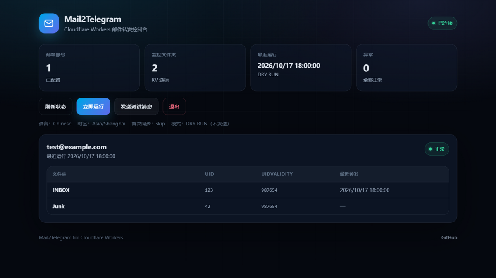

# Mail2Telegram for Cloudflare Workers

把 [Heavrnl/mail2telegram](https://github.com/Heavrnl/mail2telegram) 从「Python + IMAP IDLE 常驻进程」改造成可以在 **Cloudflare Workers** 上部署的版本：

- 用 **Cron Trigger** 定时轮询 IMAP（最小间隔 1 分钟）
- 用 **KV** 保存每个邮箱、每个文件夹的 UID 游标、登录通知状态、去重记录和运行状态
- 用 **Telegram Bot API** 转发邮件，保留原项目的 HTML 消息格式
- 不需要服务器、Docker，也不需要长期在线的进程

[](https://deploy.workers.cloudflare.com/?url=https://github.com/baipiao5555/mail2telegram-cloudflare)

> 点击按钮即可一键部署：登录 Cloudflare、填入 Telegram Token、chat id、邮箱 JSON 和管理 token，KV namespace 会自动创建。

> 本项目是原项目的衍生作品，遵循 GPL-3.0 许可证，详见 [LICENSE](./LICENSE) 和 [NOTICE](./NOTICE)。

## 功能

- 同时监控多个邮箱账号
- 自动监控 `INBOX`，并自动发现 `Junk` / `Spam` / `垃圾邮件` 文件夹
- 垃圾邮件可以转发到单独的 Telegram chat
- 支持 Gmail 应用密码、QQ 邮箱授权码等标准 IMAP 登录方式
- HTML 邮件转纯文本，自动清理脚本、样式和多余空白
- 自动识别转发邮件，显示原始收件人和原始发件人
- 首次运行可跳过历史邮件，或只转发每个文件夹最新的一封
- 邮件过大时只发送提醒，不下载正文
- 用 Message-ID 去重，尽量避免重复通知
- Telegram 消息自动分片、转义、429/5xx 重试、HTML 解析失败时退化为纯文本
- 内置可视化管理控制台，可查看邮箱/文件夹状态并手动触发运行
- 提供 `/health`、`/status`、`/run`、`/telegram/test` 管理端点



## 与 Python 版的区别

| Python 版 | 本项目 |
| --- | --- |
| 常驻进程 + IMAP IDLE，实时推送 | Cron 定时轮询，最小 1 分钟延迟 |
| `config.py` | Wrangler secrets / vars |
| 本地日志文件 | Workers Logs / `wrangler tail` |
| 断线重连、线程模型 | 每次运行重新连接，失败后下次 Cron 重试 |
| 验证码提取扩展（EVC） | 未移植 |
| 附件 | 只通知正文，不转发附件 |

Cloudflare Workers 无法运行常驻守护进程，因此不能保持 IMAP IDLE 连接。轮询是 Workers 上最稳定、成本最低的实现方式。

## 架构

```text
Cron Trigger (每分钟)
        │
        ▼
Cloudflare Worker ──TLS/993──▶ IMAP 服务器
        │                         ├─ LIST / SELECT
        │                         ├─ UID SEARCH
        │                         └─ UID FETCH (BODY.PEEK[])
        │
        ├──KV──▶ cursor:<邮箱>:<文件夹>   已处理到哪个 UID
        ├──KV──▶ seen:<邮箱>:<hash>       Message-ID 去重（7 天）
        ├──KV──▶ login:<邮箱>             登录成功通知只发一次
        └──KV──▶ status:<邮箱>            最近运行状态
        │
        ▼
Telegram Bot API (sendMessage)
```

## 前置条件

1. Cloudflare 账号
2. **建议使用 Workers Paid 计划**。免费计划每次 Cron 只有 10ms CPU，TLS 握手、MIME 解析很容易超限；Paid 计划默认 30 秒 CPU。
3. 一个 KV namespace（使用一键部署按钮时会自动创建；手动/CLI 部署需要自己创建）
4. 邮箱已开启 IMAP，并准备好应用密码 / 授权码：
   - Gmail：开启 IMAP，并按 [Google 文档](https://support.google.com/mail/answer/185833?hl=zh-Hans) 创建应用密码
   - QQ 邮箱：设置中开启 IMAP，使用授权码而不是登录密码
   - Outlook：与原项目一样，由于微软调整了连接方式，暂不支持；可把邮件转发到本项目使用的邮箱
5. Telegram Bot Token 和 chat id
6. 本地安装 Node.js 22+（仅部署和本地开发需要）

## 一键部署（推荐）

1. 点击 README 顶部的 **Deploy to Cloudflare** 按钮。
2. 登录 Cloudflare，授权 GitHub。Cloudflare 会把本仓库复制到你的 GitHub 账号下。
3. 在配置页填写以下 secrets（值来自 `.dev.vars.example` 的提示）：
   - `TELEGRAM_BOT_TOKEN`
   - `TELEGRAM_CHAT_ID`
   - `MAILBOXES`（JSON 数组，格式见下文）
   - `ADMIN_TOKEN`

   > 务必把所有占位值替换成真实值，尤其是 `MAILBOXES` 里的邮箱和应用密码。
4. 点击 **Deploy**。Cloudflare 会自动创建 KV namespace、更新绑定并部署 Worker。
5. 打开 `https://<你的-worker>.workers.dev/health`，确认 `configured: true`。
6. 打开 Worker 根地址，输入 `ADMIN_TOKEN` 进入控制台，查看状态或手动运行。
7. 可选：在 Cloudflare Dashboard → Worker → **Settings → Variables and Secrets** 中添加 `TELEGRAM_JUNK_CHAT_ID`，用于垃圾邮件分流。

说明：

- Deploy to Cloudflare 按钮要求源仓库是 **public**。
- 部署流程会读取 `.dev.vars.example` 中的 secret 名称，并让你填写真实值；不要把真实值提交到仓库。
- Cloudflare 会为你的副本建立 Workers Builds，之后往这个副本仓库推送代码会自动重新部署。

## 手动部署（CLI）

### 1. 安装依赖并登录

```bash
cd mail2telegram-cloudflare
npm install
npx wrangler login
```

### 2. 创建 KV namespace

```bash
npx wrangler kv namespace create MAIL2TG_KV
```

把命令输出的 `id` 填入 `wrangler.toml`：

```toml
[[kv_namespaces]]
binding = "MAIL2TG_KV"
id = "命令输出的 id"
```

本地 `wrangler dev` 使用本地模拟 KV，不需要 preview namespace。

### 3. 配置邮箱

邮箱列表通过 secret `MAILBOXES` 提供，JSON 数组格式：

```json
[
  {
    "email": "you@gmail.com",
    "password": "Gmail 应用密码",
    "host": "imap.gmail.com",
    "port": 993
  },
  {
    "email": "you@qq.com",
    "password": "QQ 邮箱授权码",
    "host": "imap.qq.com",
    "port": 993,
    "folders": ["INBOX", "Junk"]
  }
]
```

字段说明：

| 字段 | 必填 | 说明 |
| --- | --- | --- |
| `email` | 是 | 登录邮箱，同时作为 KV 中的账号 ID |
| `password` | 是 | 应用密码 / 授权码，保留首尾空格 |
| `host` | 是 | IMAP 服务器，只允许公网域名或公网 IP |
| `port` | 否 | 默认 `993`，必须使用隐式 TLS；端口 25 被 Workers 禁止 |
| `folders` | 否 | 手动指定文件夹。省略时自动使用 `INBOX` + 自动发现的垃圾文件夹 |
| `name` | 否 | 显示名称，会出现在 `/status` 返回结果中 |

也兼容原 `config.py` 的大写字段：

```json
[
  {
    "EMAIL": "you@gmail.com",
    "PASSWORD": "app-password",
    "IMAP_SERVER": "imap.gmail.com",
    "IMAP_SERVER_PORT": 993
  }
]
```

写入 secret：

```bash
npx wrangler secret put MAILBOXES
```

然后粘贴上面的一行 JSON（或格式化后的 JSON 也可以）。

> 文件夹名称必须是 IMAP 服务器返回的准确名称，区分大小写（`INBOX` 除外）。如果自动发现垃圾文件夹失败，用 `folders` 手动指定。除 `INBOX` 以外的文件夹都会被当作垃圾邮件，转发到 `TELEGRAM_JUNK_CHAT_ID`；未配置该 chat 时只推进游标、不转发。

### 4. 配置 Telegram 和密钥

```bash
npx wrangler secret put TELEGRAM_BOT_TOKEN
npx wrangler secret put ADMIN_TOKEN
```

`TELEGRAM_CHAT_ID` 可以直接编辑 `wrangler.toml` 的 `[vars]`，也可以作为 secret 写入：

```bash
npx wrangler secret put TELEGRAM_CHAT_ID
npx wrangler secret put TELEGRAM_JUNK_CHAT_ID   # 可选
```

获取 chat id：给机器人发一条消息，然后访问

```text
https://api.telegram.org/bot<你的BOT_TOKEN>/getUpdates
```

在返回的 JSON 中找到 `message.chat.id`。群组 ID 通常是负数。

`ADMIN_TOKEN` 用于保护 `/status`、`/run`、`/telegram/test`，建议用 32 位以上随机字符串。未设置时这些端点会返回 503。

### 5. 部署

```bash
npm run deploy
```

部署完成后 Cron Trigger 会自动生效。验证：

```bash
curl https://<你的-worker>.workers.dev/health
```

返回 `configured: true` 表示基础配置完整。浏览器打开 Worker 根地址并输入 `ADMIN_TOKEN`，可以在控制台里查看状态和执行操作。

手动触发一次并查看结果：

```bash
curl -X POST \
  -H "Authorization: Bearer <ADMIN_TOKEN>" \
  "https://<你的-worker>.workers.dev/run"
```

发送一条 Telegram 测试消息：

```bash
curl -X POST \
  -H "Authorization: Bearer <ADMIN_TOKEN>" \
  "https://<你的-worker>.workers.dev/telegram/test"
```

### 6. 调整轮询频率

`wrangler.toml` 默认每分钟轮询一次：

```toml
[triggers]
crons = ["* * * * *"]
```

如果邮箱较多，或服务商限制登录频率，可以改成每 5 分钟：

```toml
crons = ["*/5 * * * *"]
```

修改后重新 `npm run deploy`。

## 配置项

在 `wrangler.toml` 的 `[vars]` 或 Wrangler secrets 中设置。

| 名称 | 默认值 | 说明 |
| --- | --- | --- |
| `TELEGRAM_BOT_TOKEN` | 无 | **secret**，Telegram Bot Token |
| `TELEGRAM_CHAT_ID` | 无 | 普通邮件转发目标 |
| `TELEGRAM_JUNK_CHAT_ID` | 空 | 垃圾邮件转发目标；为空则跳过垃圾邮件 |
| `MAILBOXES` | 无 | **secret**，邮箱 JSON 数组 |
| `ADMIN_TOKEN` | 空 | **secret**，管理端点 Bearer token；为空时禁用管理端点 |
| `LANGUAGE` | `Chinese` | `Chinese` 或 `English` |
| `TIMEZONE` | `Asia/Shanghai` | 邮件日期显示的 IANA 时区 |
| `MAX_EMAIL_CHARS` | `3000` | 正文最多保留字符数（100–20000） |
| `MAX_EMAIL_BYTES` | `10485760` | 单封邮件最大字节数（10 MB）；超过只发提醒 |
| `MAX_MESSAGES_PER_RUN` | `20` | 每个文件夹每次最多处理多少封新邮件 |
| `INITIAL_SYNC` | `skip` | `skip` 跳过历史邮件；`latest` 转发每个文件夹最新一封 |
| `LOGIN_NOTIFY` | `true` | 每个邮箱首次登录成功时发送一次通知 |
| `DEDUPE` | `true` | 按 Message-ID 去重，保留 7 天 |
| `DRY_RUN` | `false` | 只记录日志、不调用 Telegram；**仍会推进游标** |

## HTTP 端点

| 方法 | 路径 | 鉴权 | 说明 |
| --- | --- | --- | --- |
| GET | `/health` | 无 | 健康检查，不泄露邮箱和密钥 |
| GET | `/`、`/dashboard` | 页面公开，数据需 Bearer | 可视化管理控制台 |
| GET | `/status` | Bearer | 查看每个邮箱最近运行状态、游标和错误 |
| POST | `/run` | Bearer | 立即轮询；可加 `?mailbox=you@gmail.com` 只跑一个账号 |
| POST | `/telegram/test` | Bearer | 发送测试消息 |

鉴权格式：

```text
Authorization: Bearer <ADMIN_TOKEN>
```

## 控制台

浏览器打开 Worker 根地址，输入部署时设置的 `ADMIN_TOKEN` 即可进入控制台：

- 查看每个邮箱、每个文件夹的 UID、UIDVALIDITY 和最近转发时间
- 查看最近运行时间、配置和错误信息
- 一键执行「刷新状态」「立即运行」「发送测试消息」
- Token 只保存在当前标签页的 `sessionStorage`，关闭页面后自动清除
- 未登录时页面不会加载任何邮箱数据；所有数据接口仍然要求 Bearer token
- 页面带 CSP、`X-Frame-Options: DENY`、`Referrer-Policy: no-referrer` 等安全响应头


## 行为说明

### 首次运行

- `INITIAL_SYNC=skip`（默认）：记录每个文件夹当前最大 UID，不转发已有邮件。
- `INITIAL_SYNC=latest`：转发每个文件夹最新的一封，然后记录游标。

### UIDVALIDITY 变化

IMAP 服务器重建邮箱时会改变 `UIDVALIDITY`。检测到变化后，本项目会重新建立基线，避免把旧邮件当成新邮件重复发送。

### 游标与失败重试

每成功处理一封邮件后都会把游标写入 KV。如果 Telegram 发送失败，该邮件的游标不会前进，下次 Cron 会从这封邮件重试。这样不会丢信，但如果 Telegram 配置长期错误，会阻塞该文件夹的后续邮件，`/status` 会显示错误。

每个邮箱的连接和拉取时间有 60 秒预算。如果一轮运行超过 Cron 间隔，Cloudflare 可能并发触发下一轮，造成重复通知；账号较多或网络较慢时，把 Cron 调整为 5 分钟。手动调用 `/run` 时也应避免与 Cron 同时执行。

### 去重与 KV 一致性

KV 是最终一致的，极少数情况下不同地区的 Cron 可能读到旧游标，导致重复通知。Message-ID 去重可以降低这种情况。IMAP 游标是准确性的最终来源。

### 大邮件与附件

超过 `MAX_EMAIL_BYTES` 的邮件只抓取 `FROM / SUBJECT / DATE / MESSAGE-ID` 等头信息并发送提醒。附件不会被下载或转发，只转发正文纯文本。

### 未移植的功能

原项目的 `ENABLE_EVC`（提取验证码并同步到剪贴板）依赖额外的 Python 服务和 SyncClipboard，本项目没有移植。需要的话可以在此 Worker 中自行增加本地正则提取，或调用外部服务。

## 本地开发

```bash
cp .dev.vars.example .dev.vars
# 编辑 .dev.vars，填入测试配置
npm run dev
```

`.dev.vars` 已被 `.gitignore` 忽略，不要提交真实凭据。

本地触发 Cron：

```bash
npx wrangler dev --test-scheduled
curl "http://127.0.0.1:8787/__scheduled?cron=*%2F1+*+*+*+*"
```

本地 `wrangler dev` 支持 `cloudflare:sockets` 出站 TCP，因此可以连接真实 IMAP 服务器测试（请使用测试账号）。

## 测试

```bash
npm test
npm run typecheck
npm run deploy -- --dry-run
```

测试包括：

- IMAP 响应/literal 解析
- 真实 IMAP 客户端流程（对本地假 IMAP 服务器）
- 首次基线、增量拉取、UIDVALIDITY 重置、垃圾邮件分流、每轮上限、大邮件提醒、去重
- 邮件解码与 HTML 转文本
- Telegram 分片、429 重试、HTML 退化
- 配置校验、私网地址拒绝、HTTP 鉴权

实现阶段还在本机 Workerd 中对真实 Gmail IMAP 做了 TLS 握手和 capability 解析验证（不涉及账号凭据）。

## 安全说明

- IMAP 只允许隐式 TLS（默认 993），不支持明文连接。
- 配置中的 IMAP host 会在建立连接前校验，拒绝 localhost、环回、私有、链路本地、保留地址和保留域名；连接建立后还会检查远端 IP。
- Telegram 请求固定为 `https://api.telegram.org`，并禁止重定向。
- 密码、Bot Token 只通过 Wrangler secrets 保存，不写入日志；错误信息会过滤 Token。
- Telegram 消息内容统一做 HTML 转义，邮件内容无法注入 Telegram 标记。
- `/status`、`/run`、`/telegram/test` 需要 `ADMIN_TOKEN`。

## 常见问题

**Gmail 登录失败？**
确认已开启 IMAP，并且使用的是应用密码；普通账号密码不能用于 IMAP。

**QQ 邮箱登录失败？**
需要使用授权码，并确认已开启 IMAP 服务。

**没有收到「成功登录邮箱」消息？**
检查 `LOGIN_NOTIFY`、`TELEGRAM_CHAT_ID` 和 Workers 日志。登录通知只会在第一次成功登录时发送。

**垃圾邮件没转发？**
设置 `TELEGRAM_JUNK_CHAT_ID`；如果自动发现垃圾文件夹失败，用 `folders` 手动指定准确名称。

**Telegram 返回 429？**
Worker 会按 `retry_after` 重试；如果持续 429，降低轮询频率或减少账号数量。

**免费计划能用吗？**
技术上可以部署，但 Cron 每次只有 10ms CPU，TLS + IMAP + MIME 解析很可能超限。建议使用 Workers Paid。

**邮件延迟？**
Workers 没有常驻 IDLE 连接，最小轮询间隔是 1 分钟，因此通知最多延迟约 1 分钟。

## 项目结构

```text
src/
  index.ts          Cron、HTTP 路由、鉴权
  env.ts            Env 类型与配置解析
  poll.ts           轮询编排、文件夹发现、消息处理
  state.ts          KV 游标/状态/去重
  mail.ts           MIME 解析、转发识别、正文提取
  telegram.ts       Telegram 发送、分片、重试
  security.ts       host/IP 校验、Telegram URL 校验
  util.ts           HTML 转文本、时间格式化、分片等
  imap/
    client.ts       IMAP over cloudflare:sockets
    reader.ts       字节流与 literal 解析
    parser.ts       LIST/SEARCH/UIDVALIDITY 解析、mUTF-7
test/               单元测试与本地假 IMAP 集成测试
```

## 致谢

- 原项目：[Heavrnl/mail2telegram](https://github.com/Heavrnl/mail2telegram)
- 邮件解析：[postal-mime](https://github.com/postalsys/postal-mime)
- 剪贴板扩展原作者项目：[Jeric-X/SyncClipboard](https://github.com/Jeric-X/SyncClipboard)、[Heavrnl/ExtractVerificationCode](https://github.com/Heavrnl/ExtractVerificationCode)

## License

GPL-3.0，与原项目一致。见 [LICENSE](./LICENSE)。
